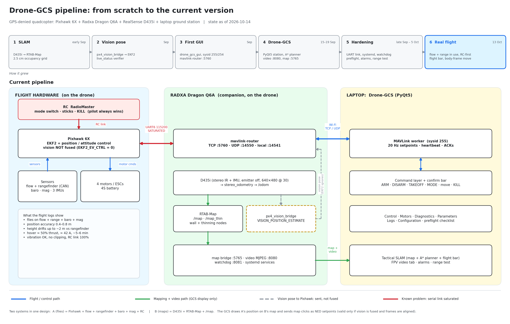

# Pipeline diagram

State as of 2026-10-14. Dates come from `Progress.md` and the README; the flight-log figures come from the two PX4 logs of the real flights (the RC flight and the failed takeoff).

**Reading it**
- **Blue** is the control path that flies the drone. **Green** is the mapping and video path, which only feeds the GCS display. **Grey dashed** is the vision pose sent to the Pixhawk, which EKF2 does not fuse (`EKF2_EV_CTRL = 0`). **Red** is the known problem: the Pixhawk to Radxa serial link is saturated.
- Two systems share one design: **A (flies)** is the Pixhawk with the flow sensor, rangefinder, barometer, magnetometer and RC. **B (maps)** is the D435i, RTAB-Map and `/map`. The GCS draws A's position on B's map and sends map clicks as NED setpoints, which is only valid if vision is fused and the frames are aligned.
